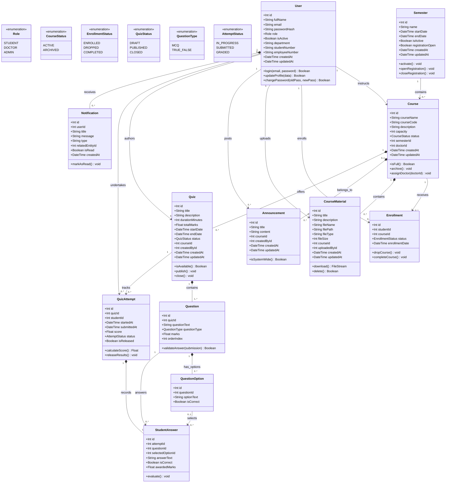

# 📐 UML Class Diagram Specification
**University Learning Management & Academic Portal**

This document provides the formal **UML Class Diagram** and relational attribute mappings for the system

---

## 1. Visual UML Class Diagram

---

## 2. Relational Attributes & Constraints Table

### 👤 `User`
| Attribute | Visibility | Data Type | Key / Constraint | Description |
| :--- | :---: | :--- | :--- | :--- |
| `id` | `+` | `Int` | **PK**, Auto-increment | Unique system identifier |
| `fullName` | `+` | `String` | Not Null | User's legal full name |
| `email` | `+` | `String` | **Unique**, Not Null | Login email address |
| `passwordHash` | `+` | `String` | Not Null | One-way bcrypt hash (60 chars) |
| `role` | `+` | `Role` | Default: `STUDENT` | Enum (`STUDENT`, `DOCTOR`, `ADMIN`) |
| `isActive` | `+` | `Boolean`| Default: `true` | Allows deactivating users |
| `department` | `+` | `String?`| Optional | E.g., "Computer Science" |
| `studentNumber` | `+` | `String?`| **Unique**, Optional | Unique student ID card number |
| `employeeNumber`| `+` | `String?`| **Unique**, Optional | Unique doctor/staff ID number |
| `createdAt` | `+` | `DateTime` | Default: `now()` | Registration audit timestamp |
| `updatedAt` | `+` | `DateTime` | Auto-updated | Profile last-modified timestamp |

---

### 📅 `Semester`
| Attribute | Visibility | Data Type | Key / Constraint | Description |
| :--- | :---: | :--- | :--- | :--- |
| `id` | `+` | `Int` | **PK**, Auto-increment | Unique semester identifier |
| `name` | `+` | `String` | Not Null | E.g. "Fall 2026", "Spring 2027" |
| `startDate` | `+` | `DateTime` | Not Null | Semester opening date |
| `endDate` | `+` | `DateTime` | Not Null | Semester closing date |
| `isActive` | `+` | `Boolean` | Default: `false` | Marks the current active term |
| `registrationOpen`| `+`| `Boolean` | Default: `false` | Controls whether registration is open |

---

### 📚 `Course`
| Attribute | Visibility | Data Type | Key / Constraint | Description |
| :--- | :---: | :--- | :--- | :--- |
| `id` | `+` | `Int` | **PK**, Auto-increment | Unique course record ID |
| `courseName` | `+` | `String` | Not Null | Title (e.g. "Software Engineering") |
| `courseCode` | `+` | `String` | **Unique**, Not Null | Catalog code (e.g. "CS301") |
| `description` | `+` | `String?` | Optional | Syllabus overview |
| `capacity` | `+` | `Int` | Default: `30` | Maximum student capacity |
| `status` | `+` | `CourseStatus`| Default: `ACTIVE`| `ACTIVE` or `ARCHIVED` |
| `semesterId` | `+` | `Int?` | **FK** $\rightarrow$ `Semester.id` | Academic semester assignment |
| `doctorId` | `+` | `Int?` | **FK** $\rightarrow$ `User.id` | Assigned instructor (`role=DOCTOR`) |

---

### 📝 `Enrollment` (Junction Entity)
| Attribute | Visibility | Data Type | Key / Constraint | Description |
| :--- | :---: | :--- | :--- | :--- |
| `id` | `+` | `Int` | **PK**, Auto-increment | Unique enrollment transaction ID |
| `studentId` | `+` | `Int` | **FK** $\rightarrow$ `User.id` | Enrolled student ID |
| `courseId` | `+` | `Int` | **FK** $\rightarrow$ `Course.id` | Registered course ID |
| `status` | `+` | `EnrollmentStatus`| Default: `ENROLLED` | `ENROLLED`, `DROPPED`, `COMPLETED` |
| `enrollmentDate`| `+`| `DateTime` | Default: `now()` | Timestamp of registration |
| *(Index)* | | | **Unique(`studentId`, `courseId`)** | Prevents duplicate enrollments |

---

### 📁 `CourseMaterial`
| Attribute | Visibility | Data Type | Key / Constraint | Description |
| :--- | :---: | :--- | :--- | :--- |
| `id` | `+` | `Int` | **PK**, Auto-increment | Unique material ID |
| `title` | `+` | `String` | Not Null | Display name (e.g. "Lecture 1: Intro") |
| `fileName` | `+` | `String` | Not Null | Actual disk/storage filename |
| `filePath` | `+` | `String` | Not Null | Storage path or cloud object key |
| `fileType` | `+` | `String` | Not Null | MIME type / extension (`pdf`, `pptx`) |
| `fileSize` | `+` | `Int` | Not Null | Size in bytes |
| `courseId` | `+` | `Int` | **FK** $\rightarrow$ `Course.id` | Associated course |
| `uploadedById`| `+` | `Int` | **FK** $\rightarrow$ `User.id` | Uploading instructor |

---

### 📢 `Announcement`
| Attribute | Visibility | Data Type | Key / Constraint | Description |
| :--- | :---: | :--- | :--- | :--- |
| `id` | `+` | `Int` | **PK**, Auto-increment | Unique announcement ID |
| `title` | `+` | `String` | Not Null | Headline |
| `content` | `+` | `String` | Not Null | Full announcement text |
| `courseId` | `+` | `Int?` | **FK** $\rightarrow$ `Course.id` (Nullable)| Null = University broadcast |
| `createdById` | `+` | `Int` | **FK** $\rightarrow$ `User.id` | Author user ID |

---

### ⏱️ Assessment Cluster (`Quiz`, `Question`, `Attempt`)

#### `Quiz`
| Attribute | Data Type | Key / Constraint | Description |
| :--- | :--- | :--- | :--- |
| `id` | `Int` | **PK** | Unique quiz ID |
| `title` | `String` | Not Null | Quiz name (e.g. "Midterm Quiz 1") |
| `durationMinutes` | `Int` | Not Null | Countdown timer limit in minutes |
| `totalMarks` | `Float` | Default: `100` | Sum of all question marks |
| `startDate` | `DateTime` | Not Null | When students can start taking it |
| `endDate` | `DateTime` | Not Null | Hard submission deadline |
| `status` | `QuizStatus` | Default: `DRAFT` | `DRAFT`, `PUBLISHED`, `CLOSED` |
| `courseId` | `Int` | **FK** $\rightarrow$ `Course.id` | Associated course |
| `createdById` | `Int` | **FK** $\rightarrow$ `User.id` | Author doctor |

#### `Question`
| Attribute | Data Type | Key / Constraint | Description |
| :--- | :--- | :--- | :--- |
| `id` | `Int` | **PK** | Unique question ID |
| `quizId` | `Int` | **FK** $\rightarrow$ `Quiz.id` | Parent quiz |
| `questionText` | `String` | Not Null | Prompt (e.g. "What is an index?") |
| `questionType` | `QuestionType` | Default: `MCQ` | `MCQ` or `TRUE_FALSE` |
| `marks` | `Float` | Default: `1` | Point weight for this question |
| `orderIndex` | `Int` | Default: `0` | Question display sequence |

#### `QuestionOption`
| Attribute | Data Type | Key / Constraint | Description |
| :--- | :--- | :--- | :--- |
| `id` | `Int` | **PK** | Unique option ID |
| `questionId` | `Int` | **FK** $\rightarrow$ `Question.id` | Parent question |
| `optionText` | `String` | Not Null | Choice text |
| `isCorrect` | `Boolean` | Default: `false` | True for the correct answer |

#### `QuizAttempt`
| Attribute | Data Type | Key / Constraint | Description |
| :--- | :--- | :--- | :--- |
| `id` | `Int` | **PK** | Unique attempt record |
| `quizId` | `Int` | **FK** $\rightarrow$ `Quiz.id` | Attempted assessment |
| `studentId` | `Int` | **FK** $\rightarrow$ `User.id` | Student taking the quiz |
| `startedAt` | `DateTime` | Default: `now()` | Attempt start timestamp |
| `submittedAt` | `DateTime?` | Optional | Completion timestamp |
| `score` | `Float?` | Optional | Auto-calculated score |
| `status` | `AttemptStatus`| Default: `IN_PROGRESS` | `IN_PROGRESS`, `SUBMITTED`, `GRADED` |
| `isReleased` | `Boolean` | Default: `false` | When true, student can view results |

#### `StudentAnswer`
| Attribute | Data Type | Key / Constraint | Description |
| :--- | :--- | :--- | :--- |
| `id` | `Int` | **PK** | Answer record ID |
| `attemptId` | `Int` | **FK** $\rightarrow$ `QuizAttempt.id` | Parent attempt |
| `questionId` | `Int` | **FK** $\rightarrow$ `Question.id` | Question answered |
| `selectedOptionId`| `Int?` | **FK** $\rightarrow$ `QuestionOption.id`| Selected MCQ choice |
| `isCorrect` | `Boolean` | Default: `false` | Result of auto-grading |
| `awardedMarks` | `Float` | Default: `0` | Calculated points earned |
| *(Index)* | | **Unique(`attemptId`, `questionId`)** | One answer per question per attempt |

---

## 3. Relationship Multiplicities Summary

| Origin Entity | Multiplicity | Target Entity | Relationship Type | Meaning |
| :--- | :---: | :--- | :---: | :--- |
| `Semester` | `1` to `0..*` | `Course` | One-to-Many | A semester offers 0 or more courses. |
| `User (Doctor)` | `1` to `0..*` | `Course` | One-to-Many | A doctor instructs 0 or more courses. |
| `User (Student)` | `1` to `0..*` | `Enrollment` | One-to-Many | A student has multiple enrollment records. |
| `Course` | `1` to `0..*` | `Enrollment` | One-to-Many | A course has multiple enrolled students. |
| `Course` | `1` to `0..*` | `CourseMaterial`| Composition (`*--`) | Materials cannot exist without a course. |
| `Course` | `1` to `0..*` | `Quiz` | Composition (`*--`) | Quizzes belong strictly to a course. |
| `Quiz` | `1` to `1..*` | `Question` | Composition (`*--`) | A quiz contains 1 or more questions. |
| `Question` | `1` to `2..*` | `QuestionOption`| Composition (`*--`) | An MCQ question has 2 or more options. |
| `QuizAttempt` | `1` to `1..*` | `StudentAnswer` | Composition (`*--`) | An attempt records answers for questions. |
| `User` | `1` to `0..*` | `Notification` | Composition (`*--`) | Notifications are tied to a recipient user. |

